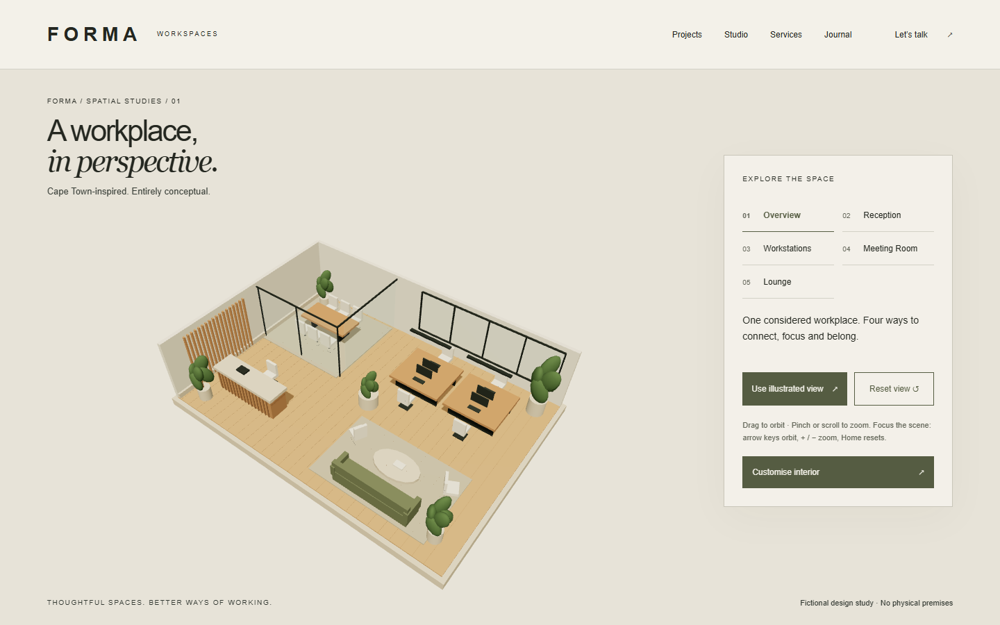
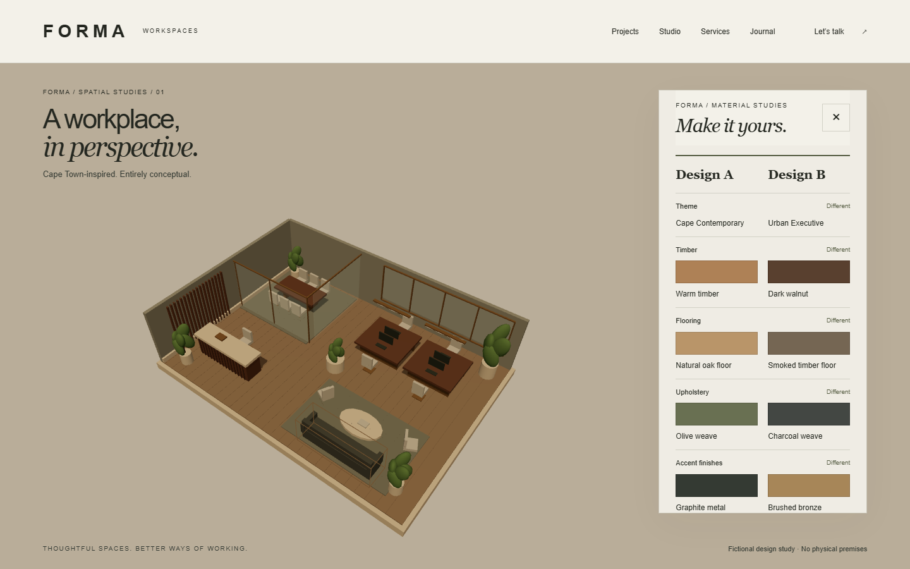

# FORMA WORKSPACES

**Source-only portfolio release.** Public source publication is authorised; Vercel deployment remains blocked pending manual device and screen-reader acceptance. Historical phase reports describe decisions at their respective dates. See [source release scope](docs/SOURCE-RELEASE.md).

**Thoughtful spaces. Better ways of working.**

An architectural website and interactive workplace design experience built with Next.js, React and Three.js. FORMA is a **fictional Cape Town commercial interior design studio**, created as a software development portfolio project. Projects, furniture, studio narratives and service areas are conceptual; no real clients, commissions, business credentials or physical office are claimed.



## Experience

- Editorial homepage with cinematic imagery, GSAP storytelling and reduced-motion alternatives.
- Six Western Cape concept projects, animated filters, approximate SVG location map and immersive case studies.
- Accessible before/after conceptual plans, six services, studio story and four original journal articles.
- Opt-in architectural showroom with five viewpoints, bounded camera controls and an illustrated WebGL fallback.
- Three interior themes, twelve finishes, three lighting presets and four selectable fictional furniture objects.
- Temporary Design A/B snapshots, comparison and restoration; branded PNG boards and browser Print / Save as PDF.
- Demo-only enquiry preview: no transmission, account, backend or personal-data persistence.



## Technology and architecture

Next.js 16 App Router, React 19, strict TypeScript, Tailwind CSS 4, GSAP/ScrollTrigger, Motion, Lenis, Three.js and React Three Fiber. Vitest, Playwright and axe-core provide automated verification. System typography and local images avoid third-party runtime font/image services.

Content routes are prerendered server components. Interactive components own local state. Three.js loads only after entering the showroom; export code loads on demand. Shared geometry/materials, instanced details, cached shadows and demand rendering limit rendering work. GSAP owns scroll storytelling; Motion owns component interactions.

```text
src/app/                    Routes, shared shell, styles, robots and sitemap
src/components/             Navigation, map, gallery, comparison and contact UI
src/components/showroom/    Scene, camera, configurator, design studies and export
src/data/                   Typed fictional projects, services and articles
src/lib/                    Metadata and approved-origin configuration
public/images/              Local imagery and original conceptual SVG plans
scripts/                    Repeatable accessibility and performance audits
tests/                     Unit and browser regression coverage
docs/                      Phase reports, asset credits and screenshots
```

## Run locally

Use Node.js 24 and npm from this directory:

```sh
npm ci
npm run dev
```

Open `http://localhost:3000`. To verify the production version:

```sh
npm run build
npm start
```

## Verification

```sh
npm run lint
npm run typecheck
npm test
npx playwright install chromium firefox webkit
npm run build
npm start
```

In a second terminal, run browser suites **sequentially**:

```sh
npx playwright test
npx playwright test --config=playwright.cross-browser.config.ts
node scripts/audit-accessibility.mjs after
node scripts/audit-performance.mjs
```

Keep other browser work and builds idle during performance measurement. Chromium covers desktop and mobile emulation. The additional suite covers configurator, design-board and readiness regressions in Firefox desktop and WebKit desktop/mobile. Playwright WebKit is not physical Safari. On the audit Windows host Firefox required execution outside the sandbox; see `scripts/check-firefox.mjs`.

Phase 4 verification: lint, strict TypeScript, production build and 18 unit tests passed; Chromium passed 67 tests (three device-specific skips), and Firefox/WebKit passed 51 targeted tests. The all-route axe audit found zero automated violations across 34 page scans and two interactive states.

Latest acceptance results and scope are recorded in [Phase 5 acceptance](docs/PHASE-5-ACCEPTANCE.md); the detailed audit remains in [Phase 4 readiness](docs/PHASE-4-READINESS.md). Historical reports remain available for [Phase 2](docs/PHASE-2.md), [3A](docs/PHASE-3A.md), [3B](docs/PHASE-3B.md) and [3C](docs/PHASE-3C.md).

## Accessibility

Semantic landmarks, visible focus, keyboard alternatives, reduced-motion support, labelled controls, menu/modal focus management and a useful static showroom are included. Automated axe scans cover all 17 public routes at desktop/mobile sizes. Passing automated checks is **not full WCAG 2.2 AA certification**. Physical-device, screen-reader and image/canvas contrast review remain necessary; the readiness report provides a manual checklist.

## Preview, security and future publication

Default builds use `noindex, nofollow`, disallow crawling and omit public canonical URLs. No production domain is invented. For a separately approved future launch, set server-side build variables:

```text
SITE_URL=https://your-approved-domain
ALLOW_INDEXING=true
```

Use an HTTPS origin without a path, credentials, query or fragment. Rebuild and verify canonical/OG URLs, sitemap and crawler policy. Setting an origin alone does not enable indexing. These settings are not access control.

Headers disable framing, MIME sniffing, unneeded camera/microphone/location permissions and form submission. The limited CSP covers objects, base URLs, framing and forms; it is not a comprehensive script policy. A nonce-based policy needs separate review of static rendering and export printing. No secrets or personal information are required. The contact form is disabled before hydration and without JavaScript.

**Nothing has been deployed, published or pushed as part of Phase 4.**

## Known limitations

- Software-rendered benchmarks vary with host load and do not predict real-device GPU performance. No historical FPS improvement is claimed.
- The 3D cutaway and material colours are illustrative, not photorealistic or manufacturer-calibrated specifications.
- Snapshots remain in local component memory and disappear on reload/navigation.
- PDF uses the browser print workflow; the exported artwork is raster, with a readable summary in the print tab.
- No CMS, real enquiry delivery, room-layout editing or commercial furniture integration is included.
- Physical iOS/Android and assistive-technology verification remain outstanding.

## Licensing and credits

See [image provenance and source links](docs/ASSETS.md). Unsplash photography illustrates fictional concepts, not the named sites or completed FORMA work. The hero is an original AI-generated fictional interior; SVG plans and procedural 3D geometry were authored for this demonstration. No external model packs or HDR assets are used.

No repository-wide code licence has been selected. Do not describe this repository as MIT-licensed or grant rights beyond the applicable asset licences; choose an appropriate code licence before an open-source release.

## Final acceptance package

Phase 5 prepares local acceptance without publishing. Start with [the acceptance report](docs/PHASE-5-ACCEPTANCE.md), [iPhone Safari/VoiceOver guide](docs/IPHONE-SAFARI-ACCEPTANCE.md), [Windows NVDA guide](docs/NVDA-ACCEPTANCE.md) and [evidence template](docs/ACCEPTANCE-EVIDENCE.md).

The [screenshot inventory](docs/SCREENSHOT-INVENTORY.md), [portfolio case study draft](docs/PORTFOLIO-CASE-STUDY.md) and [deployment checklist](docs/DEPLOYMENT-CHECKLIST.md) form the review package. Physical-device and manual screen-reader evidence remains outstanding. **GO for local review; NO-GO for public launch.** No deployment, publication or GitHub push occurred in Phase 5.

Phase 5 fresh checks: lint, TypeScript, production build and 18 unit tests passed; the final Chromium run passed 67 tests with three existing skips, and Firefox/WebKit passed 51 targeted tests. A mobile image-loading timeout in the initial Chromium run passed three unchanged isolated retests and the full rerun; its cause remains unproven. The dependency audit reported zero vulnerabilities. See the acceptance report for raw evidence and remaining gates.
